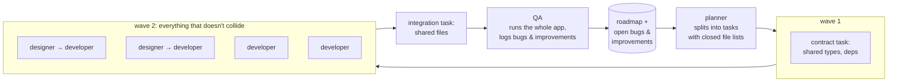

# Overclock Runtime

**Turn Claude Code into an autonomous dev crew that ships your roadmap in parallel waves, cycle after cycle.**

```
/overclock                # set up the project (new or existing)
/loop /overclock:run      # let the crew work
```

A planner splits the roadmap into tasks with **closed file lists**. Designers and developers build every
task that doesn't collide **at the same time**. QA runs the whole app at the end of the cycle and logs bugs
and improvements. The next cycle's planner turns them into tasks, and the loop keeps going until the
roadmap is done. Claude decides and proceeds on its own, and stops only for what really needs you: money,
publishing, things that are hard to undo, or contradicting a decision you made.

Overclock Runtime was extracted from a process refined by hand across several real projects (web apps and a
game). In its last version it took a fresh project through two full cycles and most of a third in a single
day: 79 tasks, 102 commits.

---

## The cycle



- **One step per invocation:** a planning, a whole wave, or the cycle's QA. With `/loop`, steps chain with no
  idle time; the scheduled wakeup is only a backup in case an agent's notification never arrives.
- **Parallel by construction:** each task lists every file it creates or changes, with an owner
  (`(designer)` or `(developer)`). Two tasks run together only if their lists don't touch.
  `overclock-plan-check` verifies the plan before anything runs.
- **Shared files don't block:** when ten screens need the same navigation file, the ten screens run in
  parallel and one `integration` task makes all the edits after them.
- **Exclusive work runs alone:** installing dependencies, generating migrations, regenerating data, or using
  a single resource (a game editor, a device) happens between waves.
- **Feedback closes the loop:** QA never creates tasks; it writes `BUGS.md` and `IMPROVEMENTS.md`, and the
  next planner plans them with the same rigor as roadmap items.

## The crew

| Role | Runs | Does | Doesn't |
|---|---|---|---|
| **run** (skill) | every step | Reads the state, starts the right agents in parallel, commits each task, writes the logs, moves to the next cycle | Read code or diffs, write tasks, design, implement |
| **planner** | start of each cycle | Turns roadmap items, bugs and improvements into tasks with closed file lists, agreed interfaces and waves; makes product and technical decisions | Write code, decide the look |
| **designer** | before the developer, on tasks with something new to see | Owns the design system, screen specs, tokens and art (or, in a game, mechanics and art direction); writes interface texts | Write app code, run the app |
| **developer** | one per task | Implements one task in its own files, validates with the project's check command, reports in the task | Commit, start the app, touch files outside its list |
| **qa** | end of each cycle | The only one who runs the app: full battery, every screen across the QA matrix, captures compared with the specs, end-to-end tests | Create tasks, fix app code |

Default models: planner on the strongest model with high effort, designer and QA on Opus, developers on
Sonnet. The planner sets the effort of each designer and developer per task, and the project can override
any role in its config.

## Install

```
/plugin marketplace add alanzdr/overclock-runtime
/plugin install overclock@overclock-runtime
```

Requirements: Claude Code, git, and Python 3 (the helper commands use only the standard library).

## Quickstart

**New project.** In an empty folder:

```
/overclock a web app where small bakeries take pre-orders
```

Overclock asks at most a few questions (what it is, stack, what the first version needs, whether it may
spend money or publish), decides the rest, and writes the project layer: product doc, roadmap with a
**C1 — Foundation** cycle, config, task files, permissions and a check script.

**Existing project.** In the repository:

```
/overclock
```

It reads the code first (manifests, scripts, folders, conventions, shared files) and asks only what the
code can't answer.

**Then run it:**

```
/loop /overclock:run
```

Or `/overclock:run` for a single step. `/overclock` alone (without the prefix) works too; if your setup
ever resolves it differently, `/overclock:overclock` is the same command.

## While it runs

| You want to | Do |
|---|---|
| Ask for a change, report a bug, make a decision | `/overclock:feedback make the header more compact` |
| Answer a question the process left | Write `**Answer:** …` under it in `.claude/tasks/QUESTIONS.md`, or use `/overclock:feedback` |
| See where it is | `overclock-status`, or just open a new session: one line tells you |
| Hold the process | Add `[paused]` to a cycle title in `.claude/docs/roadmap.md`; it stops before that cycle |
| See a finished cycle | QA leaves a `Notice:` in `QUESTIONS.md` with how to run it |

**Your decisions win.** Decisions are recorded in two tables: `A#` (yours, fixed until you change them) and
`D#` (Claude's, revisable). Feedback that changes a `D#` turns it into an `A#`, and nothing in the process
contradicts it after that.

## What it creates in your project

```
CLAUDE.md                     a block between <!-- overclock:begin/end --> markers: rules + docs map
.claude/overclock.md          project config: stack, commands, exclusive resources, shared files,
                              roles, QA matrix, git and version rules, limits (secrets, money, publishing)
.claude/settings.json         permissions for the process (merged, never overwritten)
.claude/scripts/check.py      the check command every role validates with
.claude/docs/                 product, architecture, roadmap, decisions, design system (or the
                              designer's equivalents)
.claude/tasks/                BACKLOG, BUGS, IMPROVEMENTS, QUESTIONS, open tasks, done/, logs/
.claude/roles/<role>.md       optional extra rules for one role in this project
.claude/qa/C<N>/              QA's captures (git-ignored)
```

The process itself (agents, orchestration, task format) stays in the plugin. Update the plugin and every
project gets the new process; run `/overclock` again in a project to bring its layer up to date.

Everything the process writes follows **your** language: tasks, docs, logs and commits come out in the
language you work in. Only the field labels the helper commands parse (`Status:`, `Files`, `Create:`…)
are fixed.

### The check command

Every role validates with the same contract, so the parallel flow works in any stack:

- `check --only a.ts,b.ts`: types, lint and unit tests **scoped to those files**; errors in other files
  print as `OTHER` (they belong to tasks still in progress) and don't fail.
- `check`: the whole project, run at the end of every wave.
- `check --full`: plus the production build, run by QA.

Presets ship for TypeScript web apps (Next.js, Bun, ESLint, Vitest), Unity (compiles every assembly with
`dotnet`, no editor needed) and a generic one that wraps your own commands.

## Helper commands

The plugin puts these on the `PATH` of every session:

| Command | Does |
|---|---|
| `overclock-status` | Current cycle, open tasks by status, open questions |
| `overclock-plan-check C<N>` | Validates a cycle's plan and prints its waves |
| `overclock-task T### <status>` | Moves a task's status in its file and in the backlog at once |
| `overclock-task --next-id` | The next free task id |
| `overclock-doc-sizes` | Flags process docs that grew too big for every agent to read |

## When not to use it

- **A one-off change or a small feature.** Talk to Claude directly; a cycle has planning and QA overhead
  that only pays off over many tasks.
- **When you want to approve every step.** Overclock is built to decide and proceed. If you want a gate at
  every design and plan, look at the alternatives below.
- **Without tests or a way to check the code.** The parallel flow trusts the check command between tasks
  and QA at the end. A project with neither will accumulate problems until QA.
- **There is no code review between tasks,** by design: the full check at the end of each wave and QA at
  the end of each cycle look at the whole. For code that needs a reviewer on every change (security,
  payments), review those cycles yourself or ask for it through `/overclock:feedback`.

## How it compares

| | Overclock Runtime | [Superpowers](https://github.com/obra/superpowers) | [GSD](https://github.com/open-gsd/gsd-core) | [Spec Kit](https://github.com/github/spec-kit) |
|---|---|---|---|---|
| Unit of work | a roadmap of cycles | one feature branch | phases of a project | one feature spec |
| Parallel implementers | yes, waves by closed file lists | no, one task at a time on purpose | yes, waves | no |
| Human gates | only money, publishing, irreversible, your decisions | design and plan approval | discussion and acceptance testing | after each step |
| Who tests the running app | a QA agent each cycle | tests per task, final branch review | a verifier per phase | you |
| Project bootstrap | `/overclock` (new or existing) | none | new or onboard | `specify init` |

Superpowers is excellent at disciplined, reviewed, sequential work on one feature. Overclock is for taking a
whole roadmap forward unattended. They can live side by side.

## Development

```
python3 -m unittest discover -s tests     # helper commands and skill sizes
claude plugin validate --strict .
claude --plugin-dir . -p "/overclock:run" # try it from a project folder
```

## License

MIT
