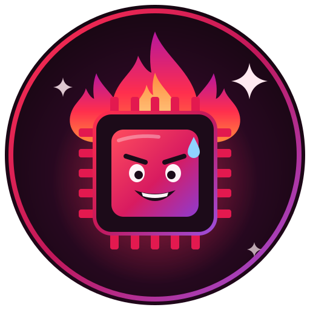
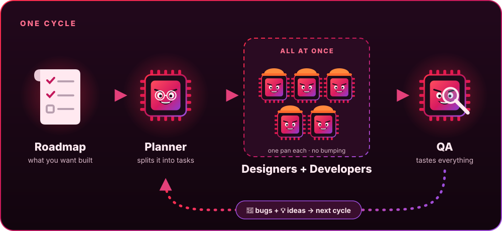
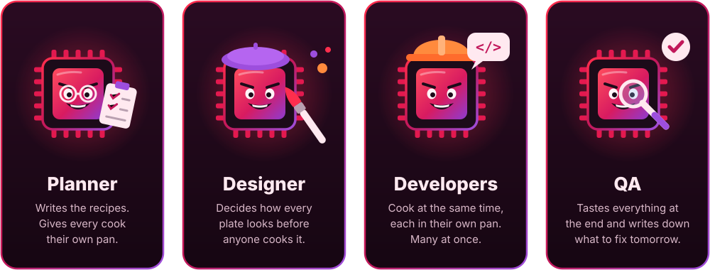
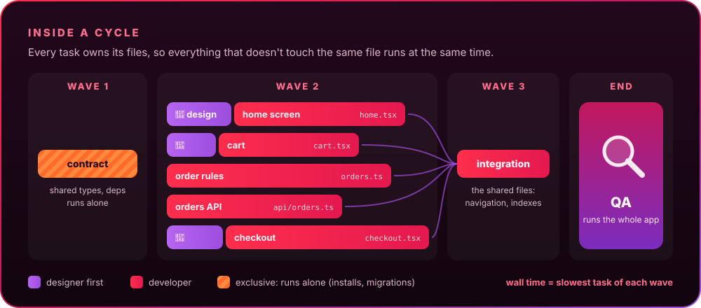

<p align="center">
  
</p>

<h1 align="center">Overclock Runtime</h1>

<p align="center">
  <b>Your roadmap, built by a crew of Claudes. In parallel. On its own.</b> 🔥
</p>

<p align="center">
  
  
  
</p>

```
/overclock               🔧 set up the project
/loop /overclock:run     🔥 let it cook
```

---

## 🍳 Explain it like I'm five

Your project is a restaurant kitchen.

- 📜 **You** write the menu: the roadmap.
- 🧠 The **planner** turns it into recipes and gives every cook **their own pan**.
- 🎨 The **designer** decides how each plate looks before anyone cooks.
- 🛠️ The **developers** cook **at the same time**. Nobody grabs someone else's pan.
- 🔍 **QA** tastes everything at the end and writes down what to fix tomorrow.
- 🔁 Tomorrow the planner starts again from that list. Until the menu is done.

<p align="center">
  
</p>

## 👩‍🍳 Meet the crew

<p align="center">
  
</p>

## ⚡ Why it's fast

<p align="center">
  
</p>

- 🗂️ **Every task lists every file it touches.** Two tasks run together only if their lists don't overlap, and
  `overclock-plan-check` proves it before anyone starts.
- 🧩 **Shared files don't block.** Ten screens need the same menu file? The ten run in parallel, and one
  **integration** task makes all the edits after them.
- 🔒 **Risky stuff runs alone.** Installing packages, migrations and data rebuilds happen between waves.

> 🌡️ Born from a hand-made process used on real projects. Its last version took a fresh project through
> two full cycles and most of a third **in one day: 79 tasks, 102 commits.**

## 🚀 Get started

**1. Install**

```
/plugin marketplace add alanzdr/overclock-runtime
/plugin install overclock@overclock-runtime
```

**2. Set up your project**

| 🆕 New project | 📦 Existing project |
|---|---|
| `/overclock a web app where bakeries take pre-orders` | `/overclock` |
| Asks a few questions, decides the rest, writes the plan | Reads your code first, asks only what the code can't tell |

**3. Let it cook**

```
/loop /overclock:run
```

> [!TIP]
> Open the project in Claude Code and accept the **trust dialog** once. Claude Code only applies the
> project's permissions in a trusted folder, and without them the crew stops to ask about every file.

Needs: Claude Code, git and Python 3.

## 🎮 While it cooks

| You want to… | Do this |
|---|---|
| 🗣️ Ask for a change, report a bug, decide something | `/overclock:feedback make the header smaller` |
| ✍️ Answer a question it left you | Write `**Answer:** …` under it in `.claude/tasks/QUESTIONS.md` |
| 👀 See where it is | `overclock-status`, or open a new session: the first line tells you |
| ⏸️ Hold it | Put `[paused]` in a cycle title in `.claude/docs/roadmap.md` |
| 🍽️ Taste a finished cycle | QA leaves a `Notice:` in `QUESTIONS.md` with how to run it |

## 🛑 When it stops to ask you

Overclock **decides and keeps going.** It only stops for four things:

| 💸 Money | 🌍 Publishing | 🧨 Can't undo | ✋ Your decisions |
|:---:|:---:|:---:|:---:|
| paid APIs, accounts, keys | deploy, push, new services | deleting data, rewriting history | anything that contradicts them |

Every decision is written down. **Yours (`A#`) are law** until you change them. Claude's (`D#`) can be
revised, and `/overclock:feedback` turns any of them into yours.

## 🤔 When *not* to use it

- 🔧 **A tiny change.** Just ask Claude: a cycle has planning and QA overhead.
- ✅ **You want to approve every step.** Overclock is built to keep going. Try the ones below.
- 🧪 **No tests and no way to check the code.** Problems pile up until QA.
- 👀 **You need code review on every change.** There is none between tasks, by design: the full check after
  each wave and QA after each cycle look at the whole.

## 🆚 How it compares

| | 🔥 Overclock | [Superpowers](https://github.com/obra/superpowers) | [GSD](https://github.com/open-gsd/gsd-core) | [Spec Kit](https://github.com/github/spec-kit) |
|---|:---:|:---:|:---:|:---:|
| Scope | whole roadmap | one feature | project phases | one feature |
| Builders in parallel | ✅ waves by file | ❌ on purpose | ✅ waves | ❌ |
| Stops for you | 4 things only | design + plan | discuss + accept | every step |
| Tests the running app | ✅ QA each cycle | branch review | verifier | you |
| Sets up your project | ✅ new or existing | ❌ | ✅ | ✅ |

Superpowers is great at careful, reviewed work on one feature. Overclock is for moving a whole roadmap
while you're away. They get along fine.

## 🧰 Under the hood

<details>
<summary><b>📁 What it creates in your project</b></summary>

```
CLAUDE.md                  a block between <!-- overclock:begin/end -->: rules + a map of the docs
.claude/overclock.md       config: stack, commands, exclusive resources, shared files, roles,
                           QA matrix, git and version rules, limits (secrets, money, publishing)
.claude/settings.json      the permissions the crew needs (merged, never overwritten)
.claude/scripts/check.py   the check command everyone validates with
.claude/docs/              product, architecture, roadmap, decisions, design system
.claude/tasks/             BACKLOG, BUGS, IMPROVEMENTS, QUESTIONS, open tasks, done/, logs/
.claude/roles/<role>.md    optional extra rules for one role
.claude/qa/C<N>/           QA's screenshots (git-ignored)
```

The process itself (agents, orchestration, task format) stays in the plugin. Update the plugin and every
project gets the new process; run `/overclock` again to refresh a project's files.

Everything it writes follows **your** language. Only the labels the helper commands read (`Status:`,
`Files`, `Create:`…) stay fixed.

</details>

<details>
<summary><b>🧪 The check command</b></summary>

One contract, any stack:

| Command | Does | When |
|---|---|---|
| `check --only a.ts,b.ts` | types, lint, unit tests **of those files**; other files' errors print as `OTHER` and don't fail | after each task |
| `check` | the same, whole project | after each wave |
| `check --full` | plus the production build | QA |

Presets ship for TypeScript web apps (Next.js, Bun, ESLint, Vitest), Unity (compiles every assembly with
`dotnet`, no editor) and a generic one that wraps your own commands.

</details>

<details>
<summary><b>🔧 Helper commands</b></summary>

The plugin puts these on the `PATH` of every session:

| Command | Does |
|---|---|
| `overclock-status` | current cycle, open tasks, open questions |
| `overclock-plan-check C<N>` | validates a cycle's plan and prints its waves |
| `overclock-task T### <status>` | moves a task's status in its file and the backlog at once |
| `overclock-task --next-id` | the next free task id |
| `overclock-doc-sizes` | flags docs that grew too big for every agent to read |
| `overclock-show <file>` | prints a template or reference from the plugin |

</details>

<details>
<summary><b>🔄 Keep it updated</b></summary>

Claude Code doesn't auto-update third-party marketplaces by default. Turn it on in `/plugin` →
Marketplaces, or in `~/.claude/settings.json`:

```json
{
  "extraKnownMarketplaces": {
    "overclock-runtime": {
      "source": { "source": "github", "repo": "alanzdr/overclock-runtime" },
      "autoUpdate": true
    }
  }
}
```

Projects set up by `/overclock` already carry this (and `enabledPlugins`) in `.claude/settings.json`, so
collaborators get the plugin and its updates too.

</details>

<details>
<summary><b>🧠 Models</b></summary>

| Role | Default |
|---|---|
| planner | the strongest model, high effort |
| designer | Opus; the strongest model when the design base changes |
| developer | Sonnet; effort set per task by the planner |
| QA | Opus, high effort |

Override any role in `.claude/overclock.md`.

**Out of Fable (or any model)?** Claude Code doesn't switch models when a usage limit hits, so Overclock
does: the failed agent is called again one step down (Fable → Opus → Sonnet), told to finish what the cut-off
attempt started, and the switch is written in the log. Only when every model is out does it stop, leaving a
`Notice:` with the reset time. Want the planner on Opus for good? Set it in `.claude/overclock.md`.

</details>

<details>
<summary><b>🛠️ Hacking on the plugin</b></summary>

```
python3 -m unittest discover -s tests       # helper commands + skill sizes
claude plugin validate --strict .
claude --plugin-dir /path/to/overclock-runtime   # try it in any project
```

</details>

---

<p align="center">
  MIT · made with 🔥 and too many cycles
</p>
